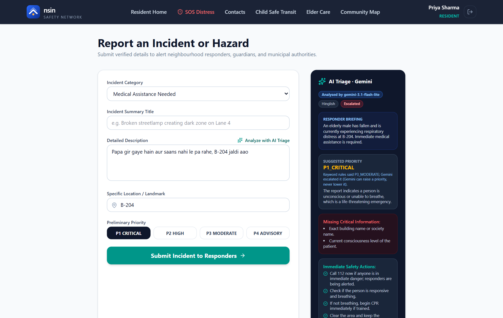
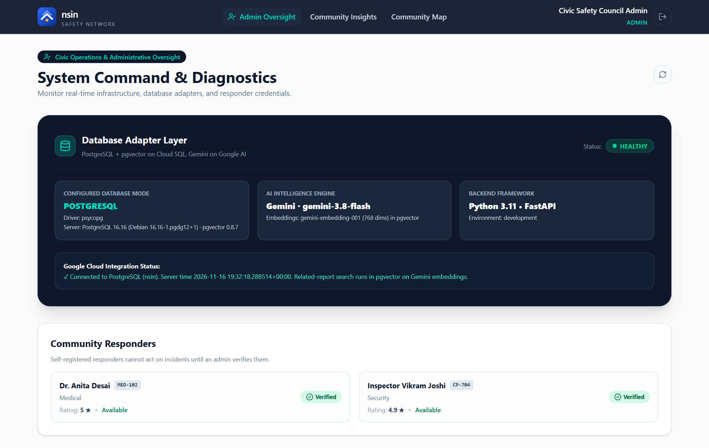
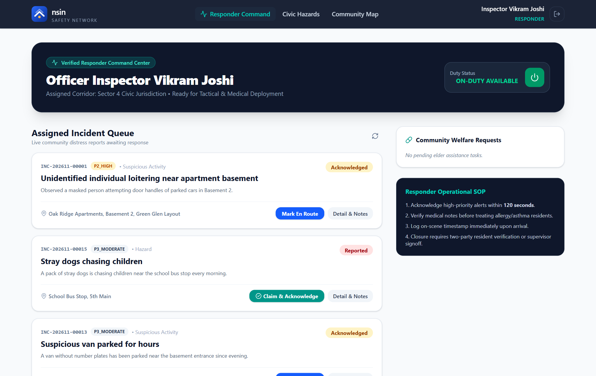
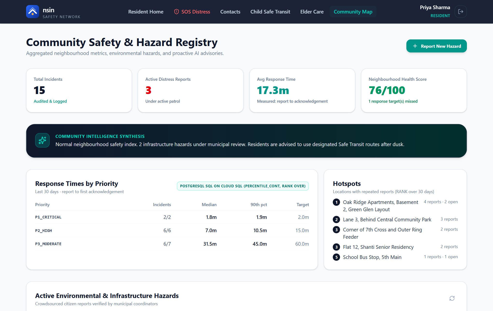
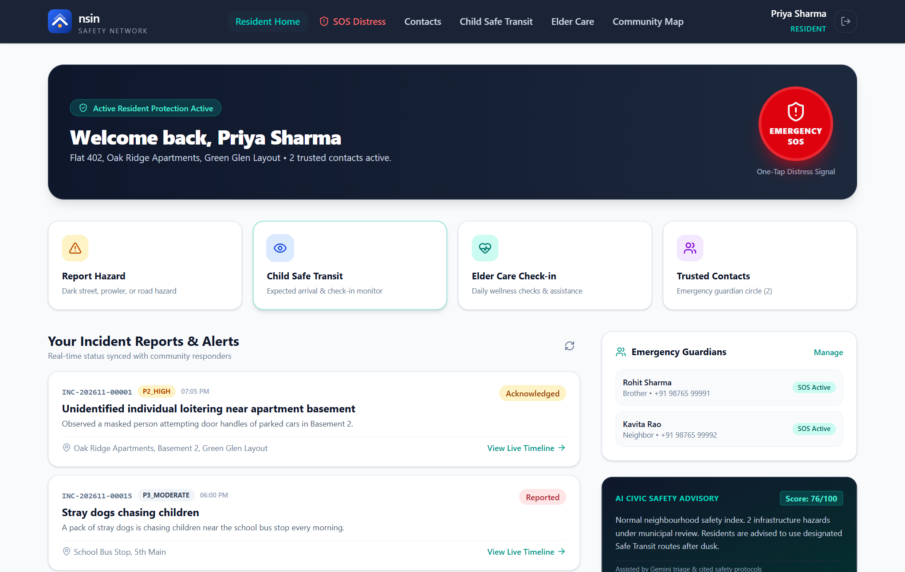
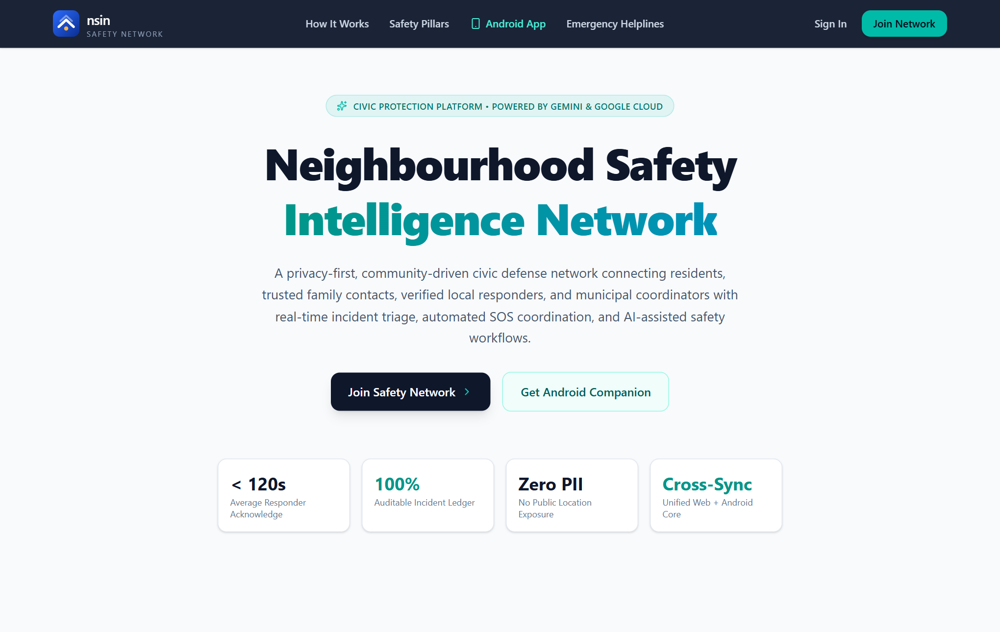
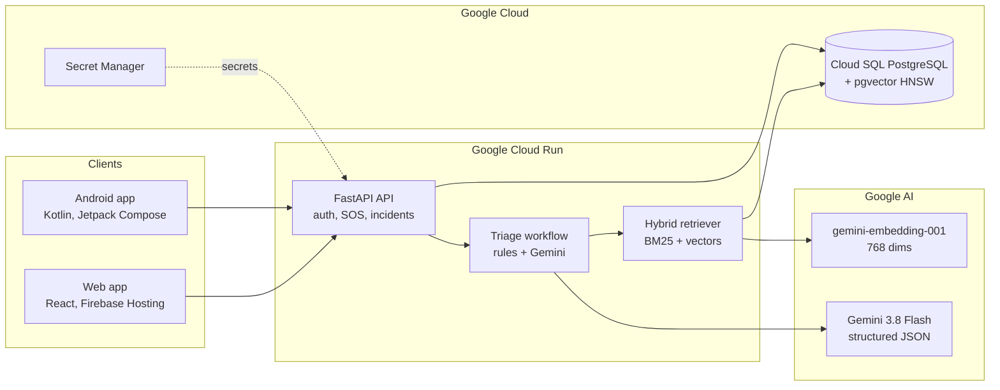

# NSIN: Neighbourhood Safety Intelligence Network

**Help is two minutes away. NSIN makes sure it knows.**

NSIN is a Gemini-powered neighbourhood emergency network for Indian cities. A resident raises a one-tap SOS or types (in English, Hindi or Hinglish) what is happening. **Gemini** triages it in seconds, the nearest **verified volunteer responder** claims it, and every step is tracked until it is resolved. The same app covers **child commutes**, **daily elder check-ins** and **community safety analytics** for RWAs.

Built by **Team Task Force 141** for **Startup Buildathon India 2026** (Google DeepMind × Google Cloud).

| | |
|---|---|
| Stage | Working MVP: Android app, web app and API |
| AI | Gemini API (`gemini-3.8-flash`, with an automatic fallback chain; structured output) + Gemini embeddings (`gemini-embedding-001`) |
| Google Cloud | Cloud Run · Cloud SQL for PostgreSQL + pgvector · Secret Manager · Cloud Build · Artifact Registry · Firebase Hosting |
| Built with | Google AI Studio (prototype) · Google Antigravity (development and testing) |
| Deploy guide | [docs/GOOGLE_CLOUD_SETUP.md](docs/GOOGLE_CLOUD_SETUP.md), written for first-time Google Cloud users |
| Website | [nsin-google-landing](https://github.com/YagnikSharma/nsin-google-landing): the landing page plus the live app at `/app/`, on Firebase Hosting |



---

## The problem
- In an emergency, the first five minutes decide the outcome, but official help in Indian cities can take 15–30+ minutes.
- The neighbour who could help in two minutes never finds out. Society WhatsApp groups bury alerts: nobody owns them, nothing is tracked, and locations are vague.
- Parents can't see whether a child reached school. Children living elsewhere can't check on parents who live alone.
- RWAs have no data on where incidents cluster or how fast help arrives.

## What NSIN does
1. **SOS in one tap.** Live location goes to verified responders and trusted contacts.
2. **Gemini triage.** It reads the report (including panicked Hinglish such as *"Papa gir gaye hain, saans nahi le pa rahe"*) and returns structured JSON: category, priority, reasoning, a responder briefing, immediate safety steps and the missing details to ask for.
3. **Rule-based safety net.** A deterministic rule engine always runs. Gemini can **raise** a priority but can **never lower** it below the rules, and if Gemini is unreachable the rules still answer. An SOS is never blocked by an AI outage.
4. **Cited protocols.** Hybrid retrieval (BM25 + Gemini embeddings in pgvector) attaches the approved safety protocol and the exact passage that matched.
5. **Responder workflow.** Claim, en route, on scene, resolved: an explicit state machine with an append-only audit trail.
6. **Related reports.** Gemini embeddings find duplicate reports of the same event (for example five residents reporting one broken streetlight).
7. **Child commute and elder check-ins.** Expected-arrival windows and missed check-ins raise alerts.
8. **Community intelligence.** Median and p90 response times, SLA breaches, hotspot ranking and incidents by hour, all computed in SQL.

## Screenshots
Captured from the running app (PostgreSQL + pgvector, real Gemini API).

| Gemini triage of a Hinglish SOS | Admin: live Cloud SQL + Gemini status |
|---|---|
|  |  |
| **Responder queue** | **Community analytics (SQL)** |
|  |  |
| **Resident home** | **Landing page** |
|  |  |

## Architecture



More detail: [architecture.md](architecture.md) · AI design and trust rules: [docs/AI_DESIGN.md](docs/AI_DESIGN.md).

## Repository layout
```
src/backend/app/
  ai/gemini.py         Google Gen AI SDK client (AI Studio key or Vertex AI), structured output, embeddings
  ai/triage.py         Rule agents + Gemini triage, merged under the "never downgrade" rule
  ai/retrieval.py      Hybrid protocol retrieval: BM25 + Gemini embeddings in pgvector, RRF fusion
  ai/vector_store.py   Related-incident search (pgvector cosine on Gemini embeddings)
  ai/briefing.py       Grounded responder briefing written by Gemini
  analytics/           Response-time and hotspot analytics in PostgreSQL SQL
  api/v1/              REST endpoints (auth, sos, incidents, responders, community, ai, ...)
  database/            PostgreSQL / Cloud SQL connection and demo seed data
  core/                Config, password hashing, JWT, login throttling, audit log
src/web-app/           React + TypeScript web app
src/android/           Android app (Kotlin, Jetpack Compose)
tests/                 pytest suite: real PostgreSQL and real Gemini, no mocks
db/least_privilege.sql Data-only database role (no DDL, append-only audit)
deploy/                setup.sh + deploy.sh for Cloud Shell
cloudbuild.yaml        Build → Artifact Registry → Cloud Run
firebase.json          Firebase Hosting for the web app
```

## Run it locally (5 minutes)
Requirements: Docker Desktop, plus optionally a free Gemini API key from [Google AI Studio](https://aistudio.google.com/apikey).

```bash
cp .env.example src/backend/.env          # then put your GEMINI_API_KEY in src/backend/.env
GEMINI_API_KEY=<your key> docker compose up --build
```
- Web app: http://localhost:3000
- API docs: http://localhost:8000/docs
- Health: http://localhost:8000/health (shows whether Gemini, pgvector and the database are active)

Demo accounts (password `Password123!`): `resident@neighbourhood.org`, `responder@neighbourhood.org`, `elder.ramesh@neighbourhood.org`, `admin@neighbourhood.org`.

Without a key everything still runs: triage uses the offline rule engine, and retrieval uses BM25 only.

## Deploy to Google Cloud
Follow [docs/GOOGLE_CLOUD_SETUP.md](docs/GOOGLE_CLOUD_SETUP.md). In short, from Google Cloud Shell:
```bash
bash deploy/setup.sh     # one time: APIs, Cloud SQL, Secret Manager, Artifact Registry, IAM
bash deploy/deploy.sh    # Cloud Build -> Cloud Run (API) + Firebase Hosting (web app)
```

## Tests
```bash
docker compose up -d db
python -m pytest tests --cov=src/backend/app
```
Everything runs against a real PostgreSQL + pgvector database and the real Gemini API. Nothing is mocked. Gemini tests are skipped (with a clear reason) when no key is set. Results and what each suite proves: [docs/TESTING.md](docs/TESTING.md).

## Security and privacy
- Role checks on every write, masked identities in public alerts, login throttling, and JWT that is refused in production with a weak secret.
- A data-only database role (no DDL, append-only audit), secrets in Secret Manager, and a non-root container.
- Gemini is advisory only: it can't lower a priority, briefings must cite a retrieved protocol, and an AI outage never blocks an SOS.

Details and scan results: [docs/SECURITY.md](docs/SECURITY.md).

## Roadmap (planned, not built yet)
| Next | Why |
|---|---|
| **Gemini Live** voice SOS | A panicked caller just talks; Gemini asks follow-up questions hands-free |
| **Gemma** on-device triage (Android) | Triage still works when the network drops, then syncs |
| **Google Agent Skills** for the dispatch agent | Packaged skills for responder matching and 112 escalation |
| **Firebase Auth + Cloud Messaging** | Phone-number sign-in and instant push alerts to responders |
| **Google Maps Platform** | Geofenced commutes and responder routing |

## Team Task Force 141
- **Yagnik Sharma**: CEO, product and AI
- **Devanshu Sharma**: CTO, architecture and cloud
- **Sameeksha**: COO, operations and community

## License
See [LICENSE](LICENSE).
