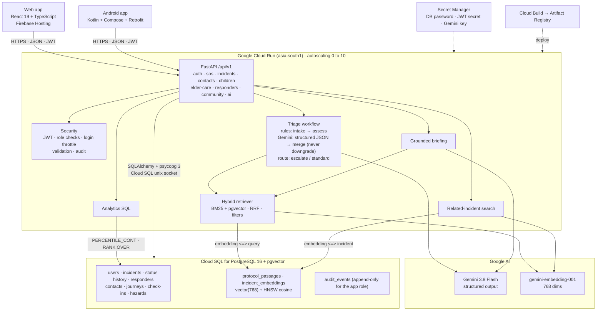

# System architecture

## Overview
NSIN has three tiers.
- **Clients:** a React web app on Firebase Hosting and a native Android app (Kotlin, Jetpack Compose).
- **API:** one FastAPI backend on **Google Cloud Run**. It owns every business rule: role checks, the incident state machine, SOS routing, journey and check-in tracking, triage, retrieval and analytics.
- **Data:** **Cloud SQL for PostgreSQL 16 with pgvector** is the system of record. It also runs vector search (HNSW, cosine) and the analytics SQL.

**Gemini** sits at the centre of the response loop. It turns free text, including Hindi and Hinglish, into a structured triage decision and a responder briefing. Its embeddings power protocol search and duplicate-report detection. A deterministic rule engine runs beside it, so the product keeps working without the model.

## Diagram

## Request flow: an SOS or incident report
1. The client posts the report. The API validates it (Pydantic; lengths match the columns), writes the incident and its status history in **one transaction**, and records an audit row.
2. **Triage** (`ai/triage.py`):
   - The **rules** classify by whole-word keywords and set a baseline priority. They never need the network.
   - **Gemini** receives the text and the rule pre-screen and returns JSON validated against a Pydantic schema: category, priority, reasoning, responder briefing, actions, missing information, language and location.
   - **Merge:** the final priority is the **more severe** of the two. Gemini can escalate, but never downgrade.
   - **Route:** a P1 is escalated, and "Call 112" becomes the first action.
   - **Retrieve:** the approved protocols for the final category are cited.
3. **Embedding.** The incident is embedded (`SEMANTIC_SIMILARITY`) into `incident_embeddings`. A failure here is logged and never blocks the report.
4. **Responders.** Responders see the queue, claim the incident and move it through the state machine. Every change is audited.
5. **Analytics.** Median and p90 time-to-acknowledge, SLA breaches, hotspots and hourly distribution are computed in SQL over the status history.

## Degradation, on purpose
| Failure | What still works |
|---|---|
| No Gemini key, quota exhausted or outage | Rule triage, BM25 protocol citations, all workflows. `/health` reports why Gemini is off |
| Embedding call fails for one incident | The incident is saved and dispatched; only "related reports" misses it |
| Dense retrieval fails for one query | That query is answered with BM25 only, and the response says so |

## Deployment
| Piece | Google product | Config |
|---|---|---|
| API container | Cloud Build → Artifact Registry → **Cloud Run** | `cloudbuild.yaml`, `src/backend/Dockerfile` |
| Database | **Cloud SQL for PostgreSQL 16** + pgvector, connected over the Cloud SQL unix socket | `INSTANCE_CONNECTION_NAME` |
| Secrets | **Secret Manager**, mounted as environment variables | `--set-secrets` in `cloudbuild.yaml` |
| Web app | **Firebase Hosting** | `firebase.json` |
| One-time setup / deploy | Cloud Shell scripts | `deploy/setup.sh`, `deploy/deploy.sh` |

## Scaling path
- **Stateless API.** Cloud Run scales out per request. Keep minimum instances at 1 during a pilot for instant SOS.
- **Database.** Cloud SQL tiers scale vertically, with read replicas for analytics. pgvector HNSW indexes keep similarity search sub-linear.
- **Per-city deployments** in `asia-south1` (Mumbai) and `asia-south2` (Delhi) give latency and data residency. Pub/Sub can fan out alerts during spikes.
- **Gemini on Vertex AI.** Set `GOOGLE_GENAI_USE_VERTEXAI=true` and Cloud Run's service account is used: no API key, provisioned throughput, and regional endpoints.
